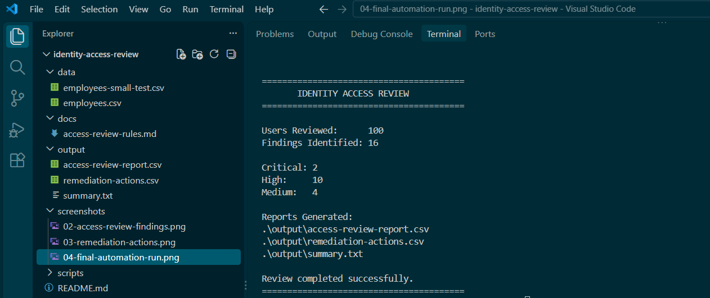

# Automated Identity Access Review

A PowerShell-based identity governance automation project that analyzes synthetic employee access data, identifies access risks, classifies findings by severity, and generates remediation recommendations and an executive summary.

## Project Overview

Identity and access management teams routinely review user access to identify risks such as excessive privileges, dormant accounts, inappropriate administrative access, and access retained after employee termination.

This project simulates an identity access review locally using PowerShell and synthetic employee data.

The automation reviews identity records against defined access governance controls and automatically generates:

- Access review findings
- Severity classifications
- Supporting evidence
- Recommended remediation actions
- Executive summary statistics

The final version analyzes **100 synthetic employee identities** and generates three reporting artifacts:

- `access-review-report.csv`
- `remediation-actions.csv`
- `summary.txt`

No production employee or identity data is used in this project.

## Automation Workflow

```text
Synthetic Identity Data
        ↓
PowerShell Access Review
        ↓
Evaluate IAM Controls
        ↓
Identify Access Risks
        ↓
Classify Severity
        ↓
Generate Remediation Actions
        ↓
Generate Executive Summary

## Access Review Controls

The PowerShell automation evaluates each identity against four access governance controls.

### 1. Terminated Account With Active Access

Identifies terminated employees who still retain group memberships.

**Severity:** High

**Recommended Action:** Disable the account and remove remaining group memberships.

### 2. Dormant Active Account

Identifies active accounts that have not logged in for more than 90 days.

**Severity:** Medium

**Recommended Action:** Review account activity and confirm whether access is still required.

### 3. Privileged Account Without MFA

Identifies privileged accounts that do not have MFA enabled.

**Severity:** Critical

**Recommended Action:** Require MFA and review privileged access.

### 4. Potential Excessive Privilege

Identifies non-IT employees with membership in the Administrators group.

**Severity:** High

**Recommended Action:** Review administrator access and validate the business requirement.

## Results

The final automated access review analyzed **100 synthetic employee identities** and identified **16 access governance findings**.

### Severity Breakdown

| Severity | Findings |
|---|---:|
| Critical | 2 |
| High | 10 |
| Medium | 4 |
| **Total** | **16** |

### Findings by Control

| Access Review Control | Findings |
|---|---:|
| Terminated Account With Active Access | 5 |
| Dormant Active Account | 4 |
| Privileged Account Without MFA | 2 |
| Potential Excessive Privilege | 5 |
| **Total** | **16** |

The automation generated three reporting artifacts:

- `access-review-report.csv` — Detailed access review findings, supporting evidence, severity, and recommended actions.
- `remediation-actions.csv` — Remediation-focused report identifying the recommended response for each finding.
- `summary.txt` — Executive summary containing the number of identities reviewed, total findings, and severity breakdown.

An individual identity can generate multiple findings when it violates more than one access governance control.

### Final Automation Run

The completed PowerShell automation reviewed 100 identities, classified findings by severity, and automatically generated all three reports.



## Project Structure

```text
identity-access-review/
│
├── README.md
├── LICENSE
│
├── data/
│   ├── employees.csv
│   └── employees-small-test.csv
│
├── docs/
│   └── access-review-rules.md
│
├── output/
│   ├── access-review-report.csv
│   ├── remediation-actions.csv
│   └── summary.txt
│
├── scripts/
│   ├── Invoke-AccessReview.ps1
│   └── New-SyntheticIdentityData.ps1
│
└── screenshots/
    ├── 01-access-review-execution.png
    ├── 02-access-review-findings.png
    ├── 03-remediation-actions.png
    └── 04-final-automation-run.png
```

## How to Run

### 1. Generate the Synthetic Identity Dataset

From the project root directory, run:

```powershell
.\scripts\New-SyntheticIdentityData.ps1
```

This generates 100 synthetic employee identities and saves them to:

```text
data/employees.csv
```

### 2. Run the Automated Access Review

Run:

```powershell
.\scripts\Invoke-AccessReview.ps1
```

The script evaluates the identity dataset against the four defined access governance controls.

### 3. Review the Generated Reports

The automation creates:

```text
output/access-review-report.csv
output/remediation-actions.csv
output/summary.txt
```

`access-review-report.csv` contains the detailed findings and supporting evidence.

`remediation-actions.csv` provides recommended remediation actions for each identified risk.

`summary.txt` provides a high-level summary of the review and severity distribution.

## Skills Demonstrated

This project demonstrates practical experience with:

- PowerShell scripting and automation
- Identity and Access Management (IAM)
- Identity Governance and Administration (IGA)
- Automated access reviews
- Privileged access analysis
- MFA control validation
- Least-privilege principles
- User and group access analysis
- Identity lifecycle and Joiner/Mover/Leaver (JML) concepts
- CSV data processing
- PowerShell objects, pipelines, loops, and conditional logic
- Security finding classification
- Automated remediation reporting
- Executive security reporting

## Key Takeaway

Identity access reviews require more than identifying accounts and group memberships. Effective reviews correlate employment status, authentication controls, account activity, privilege levels, and access assignments to identify risks that may require remediation.

This project demonstrates how PowerShell can automate that process by evaluating identity data against defined governance controls and converting the results into actionable findings and remediation recommendations.

## Disclaimer

All employee identities, access records, group memberships, and organizational data used in this project are synthetic and were created solely for demonstration and portfolio purposes.

No production identity data, employer data, credentials, or confidential information is used in this repository.